<div align="center">



<a href="https://gihananjanaw.web.app/">
  
</a>

<br/>

[](https://gihananjanaw.web.app/)
[](https://www.linkedin.com/in/gihan-anjana-7778b6268/)
[](mailto:gihangihananjana@gmail.com)
[](https://www.instagram.com/ginx_aj_/)


</div>


## 👋 About Me

```python
class GihanAnjana:
    role      = "AI & ML Engineer · Full-Stack Developer"
    location  = "Kandy, Sri Lanka 🇱🇰 (GMT +5:30) · Open to global remote"
    education = [
        "BSc (Hons) Artificial Intelligence — Kingston University London",
        "HND Computing & Software Engineering — Cardiff Metropolitan University",
        "Diploma in Software Engineering — NIBM",
    ]
    focus     = ["Deep Learning", "NLP", "Computer Vision", "Generative AI & RAG"]
    building  = "Explainable ML for Formula One race outcome prediction 🏎️"
    available = True

    def mission(self):
        return "Clean code, scalable architecture, intuitive experiences."
```

- 🧠 I bridge **AI research** with **practical full-stack engineering**, from training neural models to shipping web, mobile and desktop products
- 💼 **Software Engineer Intern** at Cerox Engineering · **Freelance AI & Software Engineer** since 2023
- 🎓 Final-year **BSc (Hons) AI** student at Kingston University London
- 📫 Reach me at **gihangihananjana@gmail.com** or through my [portfolio](https://gihananjanaw.web.app/)


## 🛠️ Tech Stack

<div align="center">


<br/>

<br/><br/>


</div>


## 🚀 Featured Projects

| # | Project | Domain | Highlights | Stack |
|---|---------|--------|------------|-------|
| 1 | **Enterprise RAG & Knowledge Assistant** | 🧠 AI / GenAI | Document Q&A with citations and sub-second retrieval over hundreds of documents | LangChain · ChromaDB · OpenAI · FastAPI |
| 2 | **Real-Time Object Detection & Tracking** | 👁️ Computer Vision | Multi-class tracking with persistent IDs on video streams, GPU-accelerated | PyTorch · YOLOv8 · DeepSORT · OpenCV |
| 3 | **Financial Sentiment & Predictive NLP Engine** | 💬 NLP | Fine-tuned FinBERT scoring news and filings, with an analytics dashboard | Hugging Face · BERT · Streamlit · Pandas |
| 4 | **MediCare Plus** | 🌐 Web | Hospital platform: EHR, scheduling, pharmacy inventory, billing, role-based portals | React · Node.js · Express · MongoDB |
| 5 | **Wedding Suit Reservation & E-Commerce** | 🌐 Web | Live slot calendar, measurements, invoicing, admin order manager | React · Node.js · MySQL · Tailwind |
| 6 | **Gym Progress Tracker & AI Fitness Coach** | 📱 Mobile | Workout logging, pose-based rep counting and form feedback, cloud sync | React Native · Android Studio · Firebase |
| 7 | **Campus Navigation & Service Platform** | 📱 Mobile | AR indoor wayfinding, lecture hall routing, service ticket dispatch | Android Studio · Kotlin · Firebase |
| 8 | **Sri Lanka Prison Management System** | 💻 Desktop | Inmate records, shift allocation, visitor logging, strict RBAC | Java · JavaFX 21 · MySQL |
| 9 | **Traffic Fine Management System** | 💻 Desktop | Automated penalty tiers, license validation, printable reports | Java · JavaFX · MySQL |

> 🔎 See demos, screenshots and write-ups on my **[portfolio](https://gihananjanaw.web.app/#projects)**.


## 🏎️ Currently Working On

**Explainable ML for Formula One race outcome prediction**: a BSc (Hons) AI final project at Kingston University London, with an interactive Streamlit dashboard that explains *why* the model predicts what it does.


## 💼 Services I Offer

| | Service | Tools |
|---|---------|-------|
| 🤖 | **AI & Machine Learning**: custom deep learning, LLMs, RAG, predictive models | PyTorch · TensorFlow · Scikit-Learn |
| 👁️ | **Computer Vision & Video AI**: detection, segmentation, tracking | YOLO · OpenCV · CUDA |
| 🌐 | **Full-Stack Web Development** | React · Node.js · MongoDB |
| 📱 | **Mobile App Development** | Android Studio · React Native · Flutter |
| 💻 | **Desktop Applications** | Java · JavaFX · C# |
| ☁️ | **APIs, Cloud & MLOps** | FastAPI · Docker · MLflow · CI/CD |


## 📊 GitHub Stats

<div align="center">


<br/>


</div>

## 🐍 Contribution Snake

<div align="center">

<picture>
  <source media="(prefers-color-scheme: dark)" srcset="https://raw.githubusercontent.com/GinxAnjana/GinxAnjana/output/github-snake-dark.svg" />
  <source media="(prefers-color-scheme: light)" srcset="https://raw.githubusercontent.com/GinxAnjana/GinxAnjana/output/github-snake.svg" />
  
</picture>

</div>


## 🤝 Let's Connect

I'm **open to AI/ML roles, software engineering opportunities and freelance projects**. If you have an idea, a product to build, or a team to join, get in touch. I usually reply within 24 hours.

<div align="center">

[](https://gihananjanaw.web.app/)
[](mailto:gihangihananjana@gmail.com)
[](https://www.linkedin.com/in/gihan-anjana-7778b6268/)

*"Clean code, scalable architecture, and intuitive user experiences."*

</div>


